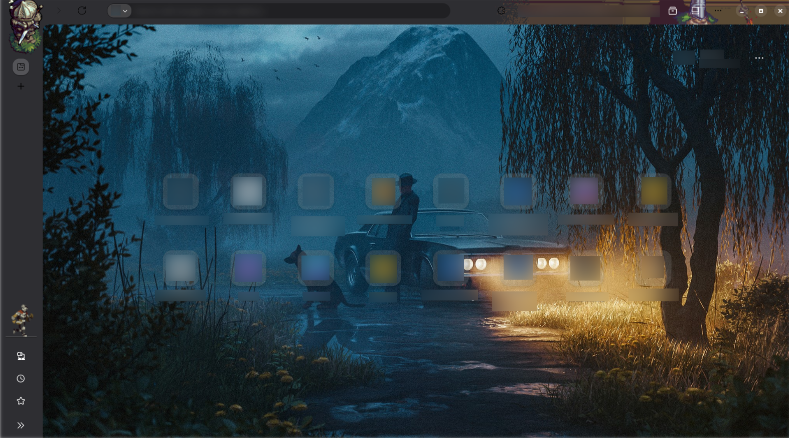

##  NewFox [Animated]
A minimal Firefox theme with userContent and userChrome.

 
 

 

🦊 I blurred my pins, weather, extensions, and search bar in the screenshot; this has nothing to do with the code.

##

##

> [!IMPORTANT] 
> 
> - Use this configuration only with Firefox 136.0.0 or later, because it relies heavily on the sidebar.

>[!TIP]
> - Check out the [main features](showcase.md)
>   
> - The theme is also available on the [firefoxcss-store](https://firefoxcss-store.github.io/themes/newfox/)
>
> - Use Nerd Fonts

##

How to Install

## Step 1 - Download the files

 - [Download](https://github.com/Mr-the-beginner/NewFox/releases/download/V1.2.3/NewFox.zip) and unzip the theme files.

## Step 1a - Enable some settings (they should be enabled by default if you are using version five or later; if not, do this)

 - In the address bar, type about:config and set these to true:
 - privacy.userContext.enabled
 - toolkit.legacyUserProfileCustomizations.stylesheets

## Step 2 - Install the files

### Linux 
 - Type about:support in the address bar.
 - Under "Application Basics," find "Profile Directory" and click "Open Directory" next to it.
 - Copy the contents of the "NewFox/profile/" directory into the folder as is, replacing files if necessary.
 - Go back to about:support. Under "Application Basics," find "Application Binary" and open that location.
 - Copy the "NewFox/defaults" directory, "config.js," and "distribution" directory there as is, replacing files if necessary.

### Windows
 - Type about:support in the address bar.
 - Under "Application Basics," find "Profile Folder" and click "Open Folder" next to it.
 - Copy the contents of the "NewFox/profile/" folder into the folder as is, replacing files if necessary.
 - Copy the "NewFox/defaults" folder, "config.js," and "distribution" folder into the main Firefox folder (where the Firefox executable is), replacing files if necessary.

### macOS
 - Type about:support in the address bar.
 - Under "Application Basics," find "Profile Directory" and click "Open Directory" next to it.
 - Copy the contents of the "NewFox/profile/" folder into the folder as is, replacing files if necessary.
 - Copy the "NewFox/defaults" directory, "config.js," and "distribution" directory into the main executable folder at "/Applications/Firefox.app/Contents/Resources/", replacing files if necessary.

## step 3 - Last touch

### Linux/macOS
- Type about:profiles.
- Find your profile (or each profile), locate "Local Directory," and click "Open Directory." Close Firefox and delete all files in the "startupCache" directory.
### Windows
- Type about:profiles.
- Find your profile (or each profile), locate "Local Folder," and click "Open Folder." Close Firefox and delete all files in the "startupCache" folder.

##

Release notes

 
1.2.3:
- Fixed the overlap in the upper/main search bar caused by the latest Firefox update.
- Fixed the green active-tab hover glow, which was being overridden by the update.
- Fixed the zoom control icon, which was not visible (I also submitted the fix to the owner of those SVGs).
- Made the new-tab + button rotate like the close-tab X button.
- Updated the JS loader, which stopped working after the latest updates.

1.2.2:
- Fixed the sidebar, which broke in version 153.0.0.
- Also made it work in Nova mode.
- Added policies.json to enable Nova and browser customization by default.

1.2.1:
- Firefox 152.0.0 broke the throbber, so I had to fix it.

1.2.0:
- Homescreen pins are now inspired by liquid glass.
- Fixed some SVGs.
- Added animated toolbar items.

1.1.0:
- Added the running knight.
- Added userChrome.js to apply JavaScript.
- Disabled some shortcuts that broke my layout (yeah, instead of fixing the code, I removed the Firefox UI elements. Call it a skill issue if you want 😇).

1.0.0:
- Base theme.

##

TODO

 
 - [ ] Fix the running knight's position in/on the sidebar.
 
 - [ ] Add more SVGs.

 - [ ] Add holiday-themed decorations that change automatically?
 

##

> [!WARNING] 
> At first, the vertical tabs may look a little odd. There are two solutions:
>
> 1st =>
> Before installing the files, make the vertical tabs as small as possible by dragging the splitter between the vertical tabs and the main screen to the left.
>
> 2nd (I'm not sure which Firefox version removed the separator from the sidebar, but this is for versions that still have it) =>
> If you have already installed the files, drag the splitter between the vertical tabs and the main screen left and right until the running knight is above the separator beneath it. This only works when there are no more than three tools in your sidebar.

> [!NOTE]
> If the weather widget is not enabled by default, do the following:
> 
> Disable "personalize-button.css" in the configs (just delete the file).
> The pencil icon will appear in the top-right corner of the home screen.
> Toggle on the weather widget, then enable the file again (restore it).

> [!CAUTION]
> The running knight will appear in the correct position only when Firefox is maximized and the screen is at 1.25x zoom. Otherwise, it may be displaced. You can, of course, adapt it to your screen by configuring "side-bar.css".
##

> I also used some code and assets that don't belong to me. Expand the list below to see links to their original owners.

  

✨ <b>Sources</b> <i>[Click to expand]</i> 👇

* 0.png, 1.png, and 2.png are from this theme: https://addons.mozilla.org/en-US/firefox/addon/praisethesun/

* The Icons folder, navbar.css, and general.css are from: https://github.com/bmFtZQ/edge-frfox

* Night-Swamp.jpg is from Adobe Premiere Pro's 2023 splash screen: https://www.behance.net/gallery/163378813/Adobe-Premiere-Pro-Splash-Screen-2023/modules/921508831

* The JS loader is from: https://github.com/Aris-t2/CustomJSforFx

* 4.png is from: https://aamatniekss.itch.io/fantasy-knight-free-pixelart-animated-character

* The liquid-glass effect was inspired by: https://freefrontend.com/css-liquid-glass/

* Coin.png and Chest.png are from itch.io

## Star History

Highest so far: 105
